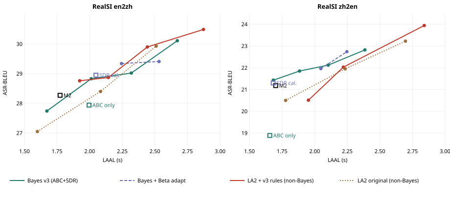

# M2 v3 配置下的 Bayesian 方法：有没有提升，和非 Bayesian 基线比怎么样

依据：[m2_fluency_results_v3.zh-CN.md](m2_fluency_results_v3.zh-CN.md)（v3 推荐配置）。数据与命令：`reports/uniss_m2_fluency_bayes_v3cfg/`。

## 结论

1. **v3 本身就是“最好的 Bayesian 方案 + v3 规则”。** v3 的 Thinker 策略是 ABC + SDR（论文中的 AmortRisk，排队速率 0.191 s/字、0.339 s/词），再加提交卫生、口语清洗、按积压选 Talker 语速、播放端 1.2 s 缓冲和块内压缩。
2. **在 v3 里，Bayesian 部件仍然有用。** 去掉 SDR、只留 ABC：
   - en→zh ASR-BLEU 显著下降 0.90（p=1.0），延迟不变；
   - zh→en 下降 2.54，但其中大部分来自一句末块失控复读（730 词）；去掉这一句后仍低 0.5。
3. **在 v3 上再加 Bayesian 没有额外收益。**
   - SDR 按实测 Talker 语速校准（0.21 / 0.318）：+0.12 / −0.13，都不显著。
   - 按场 Beta 自适应：和 SDR 落在同一条延迟–质量曲线上。它的 BLEU 更高，只是因为延迟更高；降到相同延迟后，差别在 ±0.4 以内，都不显著。论文附录里“Beta 自适应不胜过 SDR”的结论，在 v3 配置下同样成立。
4. **和非 Bayesian 的 LA2（同样加 v3 规则）比，结果分方向：**
   - **en→zh：打平。** 在 LAAL 1.9–2.7 s 的每一个配对上，差别都在 −0.9 到 +0.5 之间，都不显著。
   - **zh→en：低延迟段 Bayesian 明显更好。** 在 v3 所在的低延迟段（LAAL ≈ 1.9–2.1 s），Bayesian 高 1.3–1.6 BLEU，显著（p=0.013–0.03）。LA2 到了 LAAL 1.95 s 只有 20.51，低于 M2 的 21.18，过不了“BLEU 不降”的门槛。到 LAAL ≈ 2.2 s 时差距缩小到 +0.1 到 +0.8，不显著。
5. **v3 规则对 LA2 同样大有帮助，主要体现在流畅度上。** 以 LA2 en→zh w0.75 为例：
   - 突然停顿 4.19 → 2.67 次/分钟；
   - 扎堆 52% → 19%；
   - 等待 p90 6.3 → 2.8 s；
   - 单字块 8% → 2%。

   但同等延迟下的 BLEU 只提高约 0.4（en→zh），zh→en 不变。

**建议**
- **保留 v3 作为推荐配置，不换成 Beta 自适应或校准后的 SDR。**
- **可以接受更高延迟时，沿 v3 曲线调高偏置即可：**
  - en→zh 偏置 2：+1.28 BLEU（p=0.0），LAAL +0.66 s；
  - zh→en 偏置 0.5：+1.39 BLEU（p=0.012），LAAL +0.70 s。
- **补一个复读保护。** 无 SDR 时，一句末块陷入 “Then go to the.” 循环，长达 730 词。v3 的 `clean` 遇到句号就不再合并重复，所以没有拦住。建议在 Thinker 末块加 n-gram 重复截断。这是一个与 Bayesian 无关的稳健性问题。

## 实验设置

所有系统共用同一套组件：
- Talker：UniSS T1c@1500，`--speed-policy queue`；
- ASR：speech-only；
- 测试集：RealSI 两个方向（en→zh 346 句，zh→en 431 句）；
- 训练：没有新增训练，也没有用测试集调任何东西。

| 组 | Thinker | 读写策略 | v3 规则 | 偏置 / 窗口 |
|---|---|---|---|---|
| M2 | op1（ABC adapter） | ABC + SDR | 无 | en→zh b1，zh→en b0 |
| **v3（推荐）** | op1 | ABC + SDR 0.191 / 0.339 | 有 | en→zh b0.5 / **1** / 1.5 / 2；zh→en b**−1** / −0.5 / 0 / 0.5 |
| A 去掉 SDR | op1 | 只用 ABC | 有 | 与 v3 相同 |
| B SDR 校准 | op1 | ABC + SDR 0.21 / 0.318（实测 Talker 语速） | 有 | 与 v3 相同 |
| C Beta 自适应 | op1 | ABC + SDR + 按场 Beta 后验（ε 0.2，κ 1，n0 20） | 有 | en→zh b0.5 / 1；zh→en b−1.5 / −1 |
| LA2 原版 | 原版 Qwen3-Omni | LocalAgreement-2 | 无 | 窗口 0.5 / 0.75 / 1 s |
| **LA2 + v3** | 原版 Qwen3-Omni | LocalAgreement-2 | 有 | en→zh 窗口 0.5 / 0.6 / 0.75 / 1 s；zh→en 0.4 / 0.5 / 0.75 s |

LA2 + v3 用的是 `si_thinker_stream --policy la2 --hygiene --clean`（提交 6a18161d）。这条路径上没有 SDR，所以 Talker 一律按“空闲”处理，最小块规则始终生效。

## 延迟–质量曲线

逐句指标见 `final_{en2zh,zh2en}.json`。LAAL 以块开始时间计算；配对 bootstrap 的基准是 v3。

**en→zh**

| 系统 | ASR-BLEU | LAAL | Δ vs v3（p） | UTMOS | 异常停顿负担 | 单字块 | Talker 读错 |
|---|---|---|---|---|---|---|---|
| M2 | 28.27 | 1.77 | −0.56（0.91） | 3.226 | 5.08 | 6.9% | 4.2% |
| LA2 原版 w0.75 | 28.40 | 2.08 | −0.43（0.81） | 3.285 | 3.63 | 8.1% | 4.5% |
| LA2+v3 w0.5 | 28.76 | 1.92 | −0.07（0.52） | 3.306 | 2.74 | 1.8% | 3.7% |
| **v3** | **28.83** | **2.01** | — | **3.349** | 3.75 | 1.5% | 3.0% |
| A 去掉 SDR | 27.94 | 2.00 | **−0.90（1.0）** | 3.348 | 3.69 | 1.2% | 3.3% |
| B SDR 校准 | 28.95 | 2.05 | +0.12（0.26） | 3.337 | 3.84 | 1.3% | 2.9% |
| LA2+v3 w0.6 | 28.87 | 2.14 | +0.04（0.40） | 3.322 | 3.02 | 2.1% | 3.4% |
| C Beta b0.5 | 29.34 | 2.24 | +0.51（0.07） | 3.339 | 4.02 | 1.5% | 3.5% |
| v3 b1.5 | 29.02 | 2.32 | +0.19（0.23） | 3.342 | 4.09 | 1.3% | 3.3% |
| LA2+v3 w0.75 | 29.90 | 2.44 | +1.07（0.015） | 3.388 | 3.04 | 1.8% | 2.8% |
| C Beta b1 | 29.41 | 2.53 | +0.58（0.03） | 3.366 | 4.16 | 1.1% | 3.3% |
| v3 b2 | 30.11 | 2.67 | +1.28（0.0） | 3.347 | 4.22 | 0.9% | 3.1% |
| LA2+v3 w1 | 30.49 | 2.87 | +1.65（0.0） | 3.392 | 3.38 | 1.0% | 2.5% |

**zh→en**

| 系统 | ASR-BLEU | LAAL | Δ vs v3（p） | UTMOS | 异常停顿负担 | 单字块 | Talker 读错 |
|---|---|---|---|---|---|---|---|
| A 去掉 SDR | 18.89（去掉复读句后 20.98） | 1.66 | −2.54（0.96） | 3.219 | 4.78 | 7.0% | 3.8% |
| **v3** | **21.43** | **1.68** | — | **3.229** | 5.27 | 7.8% | 3.7% |
| B SDR 校准 | 21.30 | 1.68 | −0.13（0.71） | 3.228 | 5.11 | 7.9% | 3.6% |
| M2 | 21.18 | 1.70 | −0.26（0.71） | 3.206 | 7.11 | 15.5% | 8.9% |
| LA2 原版 w0.5 | 20.50 | 1.78 | −0.93（0.94） | 3.161 | 5.01 | 31.0% | 8.5% |
| v3 b−0.5 | 21.85 | 1.88 | +0.41（0.16） | 3.241 | 5.24 | 7.9% | 3.9% |
| LA2+v3 w0.4 | 20.51 | 1.95 | −0.92（0.89） | 3.227 | 5.50 | 11.1% | 4.5% |
| C Beta b−1.5 | 21.96 | 2.05 | +0.53（0.14） | 3.244 | 4.94 | 7.3% | 3.7% |
| v3 b0 | 22.12 | 2.10 | +0.69（0.10） | 3.263 | 5.06 | 8.0% | 3.8% |
| LA2+v3 w0.5 | 22.03 | 2.22 | +0.59（0.24） | 3.240 | 5.05 | 11.4% | 3.8% |
| LA2 原版 w0.75 | 21.95 | 2.23 | +0.52（0.23） | 3.211 | 4.82 | 23.9% | 10.2% |
| C Beta b−1 | 22.74 | 2.25 | +1.30（0.009） | 3.283 | 4.87 | 8.2% | 3.2% |
| v3 b0.5 | 22.82 | 2.38 | +1.39（0.012） | 3.268 | 4.85 | 8.2% | 3.7% |
| LA2+v3 w0.75 | 23.94 | 2.84 | +2.51（0.0） | 3.286 | 4.79 | 9.5% | 5.2% |

## 同等延迟下：Bayesian 与 LA2 + v3 的直接配对

基准是 LA2 + v3，表中的差值为 Bayesian 减 LA2 + v3（`pair_*.json`）。

| 方向 | LA2 + v3（LAAL，BLEU） | Bayesian（LAAL，BLEU） | Δ | 95% CI | p |
|---|---|---|---|---|---|
| en→zh | w0.5（1.92，28.76） | v3（2.01，28.83） | +0.07 | [−1.25, 1.14] | 0.48 |
| en→zh | w0.6（2.14，28.87） | v3（2.01，28.83） | −0.04 | [−1.30, 1.08] | 0.60 |
| en→zh | w0.6（2.14，28.87） | Beta b0.5（2.24，29.34） | +0.47 | [−0.65, 1.47] | 0.22 |
| en→zh | w0.75（2.44，29.90） | v3 b1.5（2.32，29.02） | −0.88 | [−1.93, 0.17] | 0.95 |
| en→zh | w0.75（2.44，29.90） | v3 b2（2.67，30.11） | +0.22 | [−0.84, 1.20] | 0.33 |
| zh→en | w0.4（1.95，20.51） | v3 b−0.5（1.88，21.85） | **+1.33** | [−0.03, 2.91] | 0.029 |
| zh→en | w0.4（1.95，20.51） | v3 b0（2.10，22.12） | **+1.60** | [0.17, 3.10] | 0.013 |
| zh→en | w0.4（1.95，20.51） | Beta b−1.5（2.05，21.96） | **+1.45** | [0.10, 2.95] | 0.016 |
| zh→en | w0.5（2.22，22.03） | v3 b0（2.10，22.12） | +0.09 | [−1.11, 1.51] | 0.38 |
| zh→en | w0.5（2.22，22.03） | Beta b−1（2.25，22.74） | +0.71 | [−0.44, 2.06] | 0.11 |
| zh→en | w0.5（2.22，22.03） | v3 b0.5（2.38，22.82） | +0.80 | [−0.39, 2.25] | 0.09 |

**怎么理解。**
- **zh→en：** LocalAgreement 必须等相邻两次草稿一致才提交。中文源语序与英文差得多，低延迟时草稿反复变，LA2 只能靠缩小窗口来降延迟，而小窗口意味着 BLEU 低、单字块多（11%）。ABC 直接学“现在说这一段是否安全”，所以在低延迟段占优。
- **en→zh：** 草稿更稳定，LocalAgreement 的保守提交就够用，两者打平。

## 连续时间轴（突然停顿）

整场演讲按真实时间轴连续播放，统计每分钟语音中的停顿，对应 `abrupt/*.txt` 和 `abrupt_summary.txt`。
- v3 规则的各系统都用 s1b1.2q 播放；
- LA2 原版和 M2 用 plain 播放。
- “突然” 指句中或块内、源语仍在说话时的停顿；扎堆指 10 秒内出现 3 次以上停顿。

| 方向 | 系统 | 突然停顿/分钟 | 扎堆 | 连续 LAAL | 等待 p90 | 主要原因 |
|---|---|---|---|---|---|---|
| en→zh | M2 | 4.47 | 42% | 4.46 | — | — |
| | LA2 原版 w0.75 | 4.19 | 52% | 4.25 | 6.26 | 规则或一致性扣住 53% |
| | LA2 + v3 w0.5 | 2.12 | 17% | 2.64 | 2.28 | 扣住 49% |
| | LA2 + v3 w0.6 | 2.86 | 21% | 2.99 | 2.40 | 扣住 45% |
| | **v3** | **2.38** | **24%** | **3.29** | 3.69 | 新句未开口 38%，Thinker 等 33% |
| | A 去掉 SDR | 2.40 | 19% | 3.11 | 3.56 | 同 v3 |
| | B SDR 校准 | 2.76 | 19% | 3.22 | 3.44 | 同 v3 |
| | C Beta b0.5 | 2.84 | 23% | 3.50 | 3.54 | 同 v3 |
| | v3 b1.5 | 2.49 | 18% | 3.56 | 3.69 | 同 v3 |
| zh→en | M2 | 4.72 | 44% | 3.90 | — | — |
| | LA2 原版 w0.5 | 2.35 | 32% | 4.15 | 6.50 | 扣住 47% |
| | LA2 + v3 w0.4 | 0.19 | 23% | 2.79 | 3.08 | 扣住 50%，新句 42% |
| | LA2 + v3 w0.5 | 0.72 | 25% | 3.12 | 2.92 | 扣住 44%，新句 44% |
| | **v3** | **1.32** | **27%** | **2.53** | 2.87 | Thinker 等 51%，新句 36% |
| | A 去掉 SDR | 0.71 | 23% | 3.36* | 3.34 | — |
| | B SDR 校准 | 1.48 | 28% | 2.49 | 2.77 | — |
| | C Beta b−1.5 | 1.96 | 28% | 2.81 | 2.79 | — |
| | v3 b0 | 1.83 | 26% | 2.94 | 2.91 | — |

\* 包含那一句 730 词复读造成的积压。

**观察**
- **v3 规则是 LA2 连续流畅度改善的主因**（扎堆 52% → 17–21%，等待 p90 6.3 → 2.3–2.4 s）。在这些指标上，有没有 Bayesian 的差别要小得多。
- **zh→en 上，LA2 + v3 的“突然停顿”明显更少**（0.2–0.7 对 v3 的 1.3 次/分钟）。原因是 LocalAgreement 只在两次草稿一致的位置提交，停顿多落在从句边界，被计为“新句”或“扣住”，而不是句中。代价是同等延迟下 BLEU 低 1.3–1.6（见上节）。
- **v3 的剩余停顿主要是“Thinker 在等”和“新句未开口”**，SDR 和 Beta 自适应都没有改变这个构成。要继续减少，需要的是读写时机本身的改进（参见 v3 结果中的第 3 步），而不是在 Bayesian 决策上再加一层。

## 复读问题（与 Bayesian 无关的稳健性问题）

`loops_zh2en.txt` 统计的是假设长度超过参考 3 倍且超过 30 词的句子。12 个 zh→en 系统里只有一句：A 去掉 SDR 的 `zh2en-07-ent_043`，末块重复 “Then go to the.” 共 730 词。
- 去掉这一句，各系统的 BLEU 只变化 +0.05 到 +0.07，结论不变；但 A 从 18.89 升到 20.98（仍低于 v3 的 21.50）。
- B SDR 校准里也有一句 84 词的 “Or. Or. …”，没有超过 3 倍阈值。

两者都是 Thinker 在末次读取时自回归失控。`clean` 只合并“紧邻且不跨句号”的重复，所以没有拦住。

## 文件

- `reports/uniss_m2_fluency_bayes_v3cfg/final_{dir}.json`：全部系统的逐句指标和 UTMOS，配对 bootstrap 以 v3 为基准。生成命令见 `compare_cmd.sh`。
- `pair_*.json`：同等延迟下 Bayesian 对 LA2 + v3 的配对比较。
- `abrupt/`、`abrupt_summary.txt`：连续时间轴的停顿分析。
- `utmos/`、`utmos_all.jsonl`：UTMOS。
- `frontier.svg`：延迟–质量曲线。
- `jobs/flu17–19_jobs.json`：所有 GPU 作业的完整命令。
- 系统输出：
  - `eval_outputs/.../full_iter0001500/system_{bay-*,la2v3*}`；
  - Thinker 块：`realsi_thinker_stream_bayes_v3cfg/`、`realsi_thinker_stream_la2_v3cfg/`。
