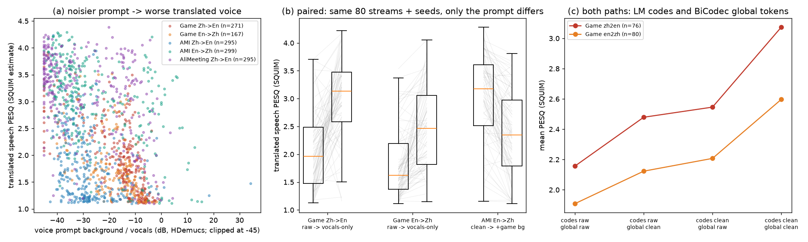

# 电竞同传试听：为什么有些译音听起来"闷"

2026-11-18，布拉格时间约 23:00。对象是试听页 `demo_packages/game_multispk_b_demo_v1` 中 baseline B（T1c Talker）生成的同传语音。

## 结论

**主因是原声的背景声（比赛 BGM、现场观众、游戏音效）。** 它通过**音色提示（voice prompt）**进入 Talker，污染了两个环节，两者各占大约一半：

1. **BiCodec 的 32 个 global token**（"音色 token"），对应 BiCodec 解码器。这组 token 不只记录说话人的音色，也会把录音环境（噪声、混响、底噪）一起编码进去。解码器按这组 token 重建声音，所以生成的嗓音自带一层"隔着东西说话"的质感。
2. **Talker 语言模型生成的语义码（semantic codes）**，对应 Talker LM。LM 的输入里有同一组 global token，它会去生成与这组 token 相配的"带噪语音"的码，所以码本身就带着噪声成分。

**听感上"闷"，不是缺高频（不是 EQ 问题），而是嗓音变"糊"：**
- 共振峰的峰谷被抹平：频谱对比度降低 1.7–2.2 dB；
- 谐波结构变弱、噪声成分变多：频谱平坦度约是干净时的 2 倍。

把提示里的背景声去掉、其他条件完全不变，同一句话的估计音质 PESQ 在中→英从 1.96 升到 3.14，在英→中从 1.62 升到 2.46，86% 的语音流变好。反过来，把电竞背景声加进干净的 AMI 提示里，PESQ 从 3.17 降到 2.35。两个方向都成立，所以这是因果关系，不只是相关。

## 1. 音色提示是怎么来的

| 环节 | 做法 | 代码 |
|---|---|---|
| 截提示 | 对每个说话人流，从**原始整段音频**里取分离器判为"只有他一个人在说"的片段（每段至少 0.4 s）。只取首次输出之前已经听到的，最近的最多 8 s。如果不足 1 s，改用**整个窗口的音频**（含其他说话人） | `gstar_talker_v6.py prep --causal` |
| 编码 | BiCodec 说话人编码器把提示编码成 32 个 global token | `si_infer.py`：`encode_wav_to_tokens(prompt)[:32]` |
| 生成 | Talker LM 以 global token、源语音 GLM token 和译文为条件，生成 BiCodec 语义码 | `si_infer.py` |
| 合成 | BiCodec 解码器根据 [global token + 语义码] 输出 16 kHz 波形 | `front.decode(...)` |

整个链路**没有任何降噪**。会议录音的背景较安静，这个问题不明显。电竞解说的原声是广播混音：解说人声底下一直垫着 BGM、观众欢呼和技能音效。所以每个提示里都带着这些声音。

## 2. 证据

所有测量都按语音流进行。

**测量工具：**
- **SQUIM**：torchaudio 的无参考音质估计，输出 PESQ、SI-SDR、STOI 的估计值。
- **HDemucs**：把提示分离成人声和背景，用来算"背景/人声"能量比（简称 BVR，越高背景越响）。
- **长时平均谱**，并在其上计算频谱平坦度和频谱对比度。

脚本见文末。

### 2.1 描述统计：电竞提示更脏，译音也更差

各组取中位数。对照组是同一个 baseline B、同一套 T1c 设置，在会议数据上随机抽的 300 条语音流。

| 集合 | 提示 BVR (dB) | 提示 PESQ | 译音 PESQ | 译音 SI-SDR (dB) | 提示 2–8 kHz 占比 (dB) | 译音 2–8 kHz 占比 (dB) | 回退提示占比 |
|---|---|---|---|---|---|---|---|
| 电竞 中→英（276 条） | **−13.7** | 1.41 | **1.89** | 12.7 | −12.8 | −13.0 | 6% |
| 电竞 英→中（168 条） | **−16.4** | 1.25 | **1.63** | 12.3 | −10.4 | −9.7 | 5% |
| AMI 英→中（真实英语会议） | −32.4 | 2.40 | 3.17 | 24.2 | −18.8 | −20.8 | 2% |
| AliMeeting 中→英 | −33.4 | 2.16 | 3.33 | 23.5 | −17.2 | −18.4 | 0% |
| AMI 中→英（中文重配音混合） | −29.7 | 1.18 | 1.62 | 12.0 | −20.7 | −22.0 | 3% |

几点说明：
- 电竞提示里的背景声比会议高约 16–20 dB，译音 PESQ 也低约 1.5。
- **电竞译音的高频占比并不比会议低，反而更高**，所以不能用"缺高频"来解释"闷"。译音的谱倾斜基本照搬提示：两者 2–8 kHz 占比的相关系数，各集合在 0.48–0.75 之间，合并后为 0.80。
- AMI 中→英的提示背景不响，但 SQUIM 也判它质量差（PESQ 1.18），它的译音同样差。这说明一般规律是"提示质量决定译音质量"，在电竞数据里，提示质量差的具体形式就是背景声。

**组内相关（Spearman）：**

| | 电竞 中→英 | 电竞 英→中 | 五组合并 |
|---|---|---|---|
| 提示 BVR 与译音 PESQ | −0.69 | −0.53 | −0.48 |
| 提示 PESQ 与译音 PESQ | +0.53 | +0.78 | +0.73 |

**按样本看：背景越响的段，译音越差。** 下表是试听页里各段的中位数。

| 样本 | 提示 BVR (dB) | 译音 PESQ | 译音 SI-SDR (dB) |
|---|---|---|---|
| gz02（KPL 年度总决赛，现场很吵） | **−6.8** | **1.32** | **2.2** |
| ge02 | −10.0 | 1.32 | 7.6 |
| ge01 | −11.8 | 1.40 | 10.0 |
| gz04 | −14.5 | 1.66 | 12.4 |
| gz01 | −13.7 | 1.92 | 14.5 |
| gz03 | −14.5 | 2.14 | 13.8 |
| ge04 | −22.7 | 1.71 | 14.5 |
| ge03 | −24.9 | 1.81 | 14.1 |
| gz05 | −21.7 | 2.29 | 16.9 |
| ge05 | −16.1 | 2.31 | 15.0 |

**最差的几处，可以在试听页里直接定位：**
- 中→英：gz03 1:23、gz02 4:10、gz04 3:25；
- 英→中：ge02 3:35–4:15、ge01 3:13。

### 2.2 因果检验：只换提示，其他完全不变

**做法：**
- 每个方向随机抽 80 条语音流（`random.Random(1)`）。
- 文本、源音频、窗口、Talker 参数都不变，条目顺序也相同。si_infer 的采样种子是"种子 + 1000 × 条目序号"，所以两组之间逐条配对。
- **唯一的改动是音色提示。**

| 对比 | 提示 BVR | 译音 PESQ | 译音 SI-SDR | 频谱平坦度（越高越"噪"） | 频谱对比度（越低越"糊"） | 改善的比例 |
|---|---|---|---|---|---|---|
| 电竞 中→英：原提示 → HDemucs 人声提示 | −14.5 → −43.0 dB | 1.96 → **3.14**（+0.94，95% CI [0.72, 1.16]） | +7.7 dB | 0.061 → 0.028 | +2.2 dB | 86% |
| 电竞 英→中：原提示 → HDemucs 人声提示 | −17.7 → −40.5 dB | 1.62 → **2.46**（+0.66，[0.51, 0.82]） | +5.8 dB | 0.135 → 0.080 | +1.7 dB | 86% |
| AMI 英→中：干净提示 → 混入电竞背景（−15 dB） | −31.4 → −17.9 dB | 3.17 → **2.35**（−0.69，[−0.86, −0.53]） | −5.0 dB | 0.012 → 0.023 | −1.3 dB | 86% 变差 |

PESQ 和 SI-SDR 的差异，Wilcoxon 检验都是 p < 1e-7；频谱平坦度和对比度差异的 bootstrap 95% 置信区间都不含 0。

- **高频占比几乎不变**：去背景后 4–8 kHz 甚至略降 0.8–1.9 dB。所以改善的不是"亮度"，而是嗓音本身干不干净。
- "混入电竞背景"的 −15 dB 约等于电竞提示 BVR 的中位数。背景取自电竞提示减去人声分离结果后剩下的部分。

### 2.3 背景具体污染了哪一环：2×2 拆分

用上面两组的输出做一个 2×2：语义码 {原提示组 / 人声提示组} × global token {原提示 / 人声提示}。语义码是把各组生成的语音用 BiCodec 重新编码得到的（结果文件里只存了码的个数）。四个格子都经过同一次"编码再解码"，所以可以互相比较。

| | 码 原 + token 原 | 码 原 + token 净 | 码 净 + token 原 | 码 净 + token 净 | global token 效应 | 语义码效应 | 交互 |
|---|---|---|---|---|---|---|---|
| 中→英 PESQ（76 条） | 2.10 | 2.50 | 2.60 | 3.19 | +0.43 [0.35, 0.50] | +0.49 [0.32, 0.65] | +0.21 |
| 英→中 PESQ（80 条） | 1.77 | 1.91 | 2.07 | 2.57 | +0.30 [0.24, 0.37] | +0.39 [0.28, 0.50] | +0.17 |

- **解码器这一环（global token）约占一半。** 同一串语义码，只换成干净提示的 token，就明显变干净。
- **LM 这一环（语义码）约占另一半。** 两组 LM 的输入只差这 32 个 token，但 LM 生成的码不一样了。带噪 token 引出的码在 4–8 kHz 多出 1.1–1.9 dB 类似噪声的能量，相当于"把底噪也说了出来"。
- **两环同时干净时还有额外收益**（交互为正）。所以只在输出端做降噪不够：LM 生成的码已经带噪，共振峰被抹平的问题也无法在输出端还原。

### 2.4 次要因素

**回退提示**（不到 1 s 的单人片段，改用整个窗口的音频，混入了其他解说的声音）：
- 中→英有 16 条（6%），译音 PESQ 1.59，单人提示为 1.89；
- 英→中有 8 条（5%），1.54 对 1.63。

条数少，影响也小。

**同传声道里多路译音叠在一起：**
- 15–60% 的译音时间里有两路以上同时在说，大部分是不同解说的译音互相重叠（见 `LOG.zh-CN.md` 当日条目）。
- 两个"糊"的嗓音叠在一起会更浑，但这是播放时的问题，与单路嗓音"闷"无关。

**不是原因的几项：**
- **带宽**：BiCodec 是 16 kHz；试听页的原声声道也是 16 kHz（kenxsong 数据的整段音频本来就是 16 kHz）。两个声道的带宽一样，所以带宽不是两者的差别。和 YouTube 原视频比，两个声道都缺 8 kHz 以上的部分。
- **MP3 编码和响度归一**：两个声道用同一个编码器，归一到相同的有效 RMS。
- **提示长度**：中位数都是满 8 s；时长与译音 PESQ 的相关很弱（|ρ| ≤ 0.2，方向在各集合间不一致）。

## 3. 自己听验证

`demo_packages/game_muffle_ab_examples_v1/<方向>/<流 id>/` 里每条流有 4 个文件：
1. `1_prompt_raw.wav`：原始提示；
2. `2_prompt_vocals.wav`：去背景后的提示；
3. `3_translation_raw_prompt.wav`：用原提示生成的译音；
4. `4_translation_vocals_prompt.wav`：用去背景提示生成的译音。

每个方向的前 3 条是改善最大的（为了让差别容易听出来），第 4 条是改善程度居中的典型例子。清单在 `examples.json`。

| 流 | 在试听页的位置 | 提示 BVR | PESQ 原 → 净 |
|---|---|---|---|
| gz02_on_0014__S3 | gz02 3:10 | −7.0 | 1.31 → 4.15 |
| gz02_on_0002__S1 | gz02 0:40 | −8.2 | 1.18 → 3.96 |
| gz02_on_0007__S3 | gz02 1:47 | −6.5 | 1.48 → 4.07 |
| gz03_on_0003__S2（典型） | gz03 0:33 | −12.6 | 1.65 → 2.67 |
| ge02_on_0006__S4 | ge02 1:42 | −8.2 | 1.15 → 3.85 |
| ge02_on_0012__S4 | ge02 3:36 | −3.6 | 1.12 → 3.62 |
| ge02_on_0007__S4 | ge02 2:02 | −7.3 | 1.22 → 3.53 |
| ge03_on_0003__S2（典型） | ge03 1:00 | −25.1 | 1.53 → 2.01 |

## 4. 改进方向（按"证据强度 / 改动量"排序）

1. **先给提示去背景，再编码 global token。**
   - 2.2 节已经直接证明有效：PESQ +0.66 到 +0.94。
   - 提示本来就取自"已经听到的过去音频"，所以不增加前瞻延迟。每个说话人只需处理一次并缓存。
   - HDemucs 偏重；流式场景可以换成更轻的因果降噪器，例如本机已缓存权重的 DeepFilterNet3，但需要先在本项目的环境中装好。
2. **选最干净的片段做提示，而不是最近的 8 s。** 用估计 SNR 或 BVR 给单人片段排序，并把每位说话人的音色锁定（si_infer 已有 `BayesVoiceMemory`）。不需要额外的模型。
3. **训练端：提示加噪、目标保持干净。** 让 Talker 和解码器学会忽略录音环境，从根上解决 LM 那一半。改动最大。
4. **输出端降噪**只能去掉一部分底噪，无法恢复被抹平的共振峰（见 2.3 节），只适合作为补充。
5. **重叠播放**（2.4 节）可以交给 MIST 的播放层（PA）处理，与嗓音"闷"是两回事。

## 5. 注意事项

- **SQUIM 是无参考的估计**（基于 DNS 数据训练），不等于人工 MOS。频谱平坦度和对比度是客观声学量。"闷"是听感，本报告用这几项客观量共同描述，没有做主观听测。
- **HDemucs 的人声分离会带入少量失真。** 即便如此，用它做提示仍然大幅改善了译音，所以结论不受影响。
- **2×2 拆分的语义码来自重新编码**，各格子的绝对值与原始输出（2.2 节）略有不同。效应的方向和量级是可比的。
- **AMI 的两组在第一次运行时**因 vLLM 显存探测竞争而启动失败（同卡另一任务恰好在这时释放显存）。已改为单独重跑；失败的目录改名保留为 `*.failed_meminit`。
- **为做分析，从 download.pytorch.org 下载了 torchaudio 官方权重** `squim_objective_dns2020.pth` 和 `hdemucs_high_trained.pt`，放在 `cache/torch/hub/checkpoints`。

## 6. 文件

**脚本（`experiments/mist_w3po_v1/`）：**
- `evaluation/game_muffle_analysis.py`：逐流测提示和译音，并保存人声分离结果；
- `evaluation/game_prompt_swap.py`：构造三组换提示的输入；
- `scripts/game_swap_run.sh`：在卡 0 和卡 2 上跑这几组 Talker；
- `evaluation/game_codec_swap.py`、`evaluation/game_codec_swap_measure.py`：2×2 拆分；
- `evaluation/game_voice_texture.py`：频谱平坦度和对比度；
- `evaluation/game_muffle_figure.py`：画图。

**数据：**
- `eval_outputs/mist_w3po_v1/game_muffle_v1/`：逐流测量 `*.jsonl`、`vocals_prompt/`、`codec_swap/`；
- `eval_outputs/mist_w3po_v1/speech/game_swap_*`：换提示后重跑的 Talker 输出。
